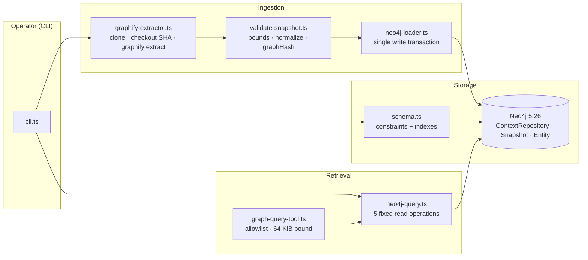
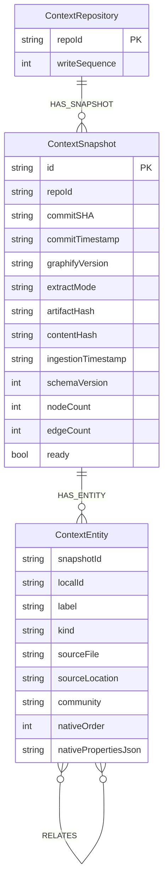
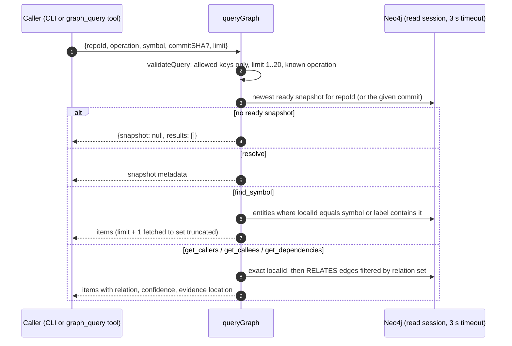

# Design

Target layout:

```text
context/
  ingestion/
    extract/
      code/
    load/
  storage/
    neo4j/
  retrieval/
    query/
  testing/
  docs/

infra/
  neo4j/
```

Flow:

```text
local source checkout
  -> Graphify extraction
  -> validated snapshot
  -> Neo4j loader
  -> Neo4j storage
  -> graph retrieval query
```

Status: implemented and verified on the designated test host on 2026-10-06 (results in `docs/design/verification.md`). Everything below describes the code as built.

## Components

| Component | File | Responsibility |
|---|---|---|
| Types and identity | `context/types.ts` | `RepositorySnapshot`, `GraphNode`, `GraphEdge`; `requiredText` (no control characters, length bound); `commitSHA` (full lowercase 40 or 64 hex); `snapshotId` = `JSON.stringify([repoId, sha])` |
| Extractor | `ingestion/extract/code/graphify-extractor.ts` | Clones the repo into a temp dir, checks out the exact SHA, refuses submodules and symlinks, runs Graphify, reads its `graph.json` |
| Validator and normalizer | `ingestion/load/validate-snapshot.ts` | Bounds, shape checks, dangling-edge and duplicate-id rejection, deterministic ordering, `graphHash` |
| Loader | `ingestion/load/neo4j-loader.ts` | One write transaction: repo lock, create-or-compare, batched entity and edge insert, `ready = true` |
| Schema | `storage/neo4j/schema.ts` | Additive, idempotent constraints and indexes (V1 structural, V2 chunk vector index) |
| Query | `retrieval/query/neo4j-query.ts` | Five fixed read operations, no caller-supplied Cypher |
| Model-callable tool | `retrieval/query/graph-query-tool.ts` | `graph_query` wrapper: repo allowlist, 64 KiB output bound |
| Operator CLI | `context/cli.ts` | `init-schema`, `extract`, `ingest`, `load`, `query`, `verify` (plus the 002 commands) |



## Ingest sequence (`ingest <repoId> <repoPath> <sha> <snapshot.json|->`)

```mermaid
sequenceDiagram
    autonumber
    participant Op as Operator
    participant CLI as cli.ts
    participant Ex as Extractor
    participant Git as git (temp clone)
    participant G as Graphify 0.9.51
    participant V as Validator
    participant L as Loader
    participant DB as Neo4j

    Op->>CLI: ingest repo path sha out.json
    CLI->>Ex: extractRepository (120 s abort)
    Ex->>Ex: check graphifyy version == 0.9.51
    Ex->>Git: clone --no-local --no-checkout, checkout --detach sha
    Ex->>Git: rev-parse HEAD must equal sha
    Ex->>Git: ls-tree: refuse submodules (mode 160000)
    Ex->>Ex: refuse symlinks
    Ex->>G: graphify extract --code-only --no-viz
    G-->>Ex: graph.json (reject if over 32 MiB)
    Ex->>V: normalizeGraph(raw)
    V-->>Ex: sorted nodes and edges, no dangling edges
    Ex-->>CLI: RepositorySnapshot (artifactHash = sha256 of graph.json)
    CLI->>CLI: write out.json (wx); if it exists, hashes must match
    CLI->>DB: initializeSchema (idempotent)
    CLI->>L: loadSnapshot
    L->>V: validateSnapshot, graphHash
    L->>DB: BEGIN, MERGE repo, bump writeSequence (repo write lock)
    alt snapshot id exists
        L->>DB: read contentHash
        DB-->>L: hash
        L-->>CLI: unchanged (or error: immutable snapshot conflict)
    else new
        L->>DB: CREATE snapshot, entities in batches of 500, edges in batches of 500
        L->>DB: SET ready = true, COMMIT
        L-->>CLI: created
    end
    CLI-->>Op: JSON with status, graphHash, artifactHash, nodes, edges
```

Readiness is atomic: the snapshot, its entities and edges, and `ready = true` become visible in one commit. There is no half-loaded snapshot a reader could see. Structural snapshots have no `building` state (the semantic layer in feature 002 does, because embedding takes tens of minutes).

## Data model



`RELATES` carries `relation`, `confidence`, `sourceFile`, `sourceLocation`, `context`, `nativeOrder` and `nativePropertiesJson`. Direction is preserved: a `calls` edge runs from caller to callee.

Constraints and indexes (V1): unique `ContextRepository.repoId`; unique `ContextSnapshot.id`; unique `(ContextEntity.snapshotId, localId)`; index on `ContextSnapshot(repoId, commitTimestamp)` for latest-snapshot resolution. Migrations are additive and never rewrite earlier ones.

## Identity, immutability and hashing

- Snapshot identity is `(repoId, commitSHA)`. A snapshot is immutable once created.
- `graphHash` is the SHA-256 of the normalized snapshot excluding `repositoryPath` (the checkout location is deployment metadata). Nodes are sorted by id and edges by their serialized form, so the hash does not depend on Graphify's output order or on where the repo was checked out.
- `artifactHash` is the SHA-256 of Graphify's raw `graph.json`, so it also pins the extractor's exact bytes.
- Ingesting the same commit again with the same content returns `unchanged`. Ingesting it with different content (a different Graphify version, for example) fails with "Immutable snapshot conflict" instead of overwriting.
- The original Graphify objects are kept as `nativePropertiesJson` and `nativeOrder` so the exact native graph can be rebuilt later (the MCP server relies on this for parity with Graphify's own functions).

## Validation rules and bounds

| Rule | Limit or behaviour |
|---|---|
| Nodes / edges per snapshot | at most 50,000 / 200,000 |
| Graphify output file | at most 32 MiB |
| Text fields | non-empty, no control characters, bounded length (ids and labels 1024, `sourceFile` and `sourceLocation` 4096) |
| `sourceFile` | repository-relative: no absolute path, no `..`, no backslash, no drive letter |
| Duplicate node ids | rejected |
| Edge endpoints not in the node set (dangling) | rejected |
| `commitSHA` | full lowercase 40 or 64 hex characters |
| Extraction time | 120 s abort; load transaction timeout 30 s |

## Query design



- Operations: `resolve`, `find_symbol`, `get_callers`, `get_callees`, `get_dependencies`. There is no way to pass Cypher.
- `get_callers` and `get_callees` follow `calls`; `get_dependencies` follows `imports`, `imports_from`, `uses`, `depends_on`, `requires`.
- Relationship operations need the exact `localId` (as returned by `find_symbol`), so two symbols with the same name can never be confused.
- Default snapshot is the newest ready one by `commitTimestamp` (ties broken by `commitSHA`); pass `commitSHA` to pin a version. Every result is scoped to one repository and one snapshot.
- `graph_query` (the model-callable wrapper) additionally requires the repo to be listed in the operator-set `TAFFEE_CONTEXT_REPOS`, bounds the response at 64 KiB by dropping whole results (never slicing JSON), and replaces internal errors with a generic message.

## Operator CLI reference

| Command | Effect |
|---|---|
| `init-schema` | Create constraints and indexes (idempotent) |
| `extract <repoId> <repoPath> <sha> <out.json\|->` | Extract only; write the snapshot file or print it |
| `ingest <repoId> <repoPath> <sha> <out.json\|->` | Extract, then load; prints `created` or `unchanged` with hashes and counts |
| `load <snapshot.json>` | Load a saved snapshot file |
| `query <repoId> <operation> [symbol\|-] [sha\|-] [limit]` | Run one of the five read operations |
| `verify <repoId> <sha> <snapshot.json>` | Compare stored hash, artifact hash and counts with the saved file |

## Failure modes

| Failure | Behaviour |
|---|---|
| Graphify not at 0.9.51 | Extraction stops with the found version |
| Checkout does not match the requested SHA | Extraction stops |
| Submodule in the tree | Refused ("require separate ingestion") |
| Symlink in the tree | Refused (covered by a live test) |
| Graphify output over 32 MiB, or graph over the node/edge bounds | Refused |
| Malformed graph (dangling edge, duplicate id, escaping path) | Refused before any write |
| Same commit, different content | "Immutable snapshot conflict"; nothing changes |
| Two ingests of one repo at once | Serialized by the repository write lock; the second sees the first's snapshot |
| Failure mid-load | Transaction rolls back; no `ready` snapshot exists |
| Existing snapshot file with different content | `extract` and `ingest` refuse to overwrite it |

## Known limitations

- `verify` compares the stored content hash, artifact hash and counts. It does not recompute the hash from stored node and edge properties, so editing one node's property without changing counts is not detected (shown in the tamper test).
- Submodule refusal and the 32 MiB bound have no test.
- Extraction is code-only (tree-sitter structure, no LLM), so dynamic calls, reflection and generated code are not captured. Why code-only: [DECISIONS.md](DECISIONS.md) 006.
- Calls made from inside nested functions are not recorded as caller edges (found in the FastAPI eval, `eval/results/2026-11-14-fastapi/REPORT.md`).
- Largest repository run so far is NestJS, with 15,185 nodes and 36,714 edges.
