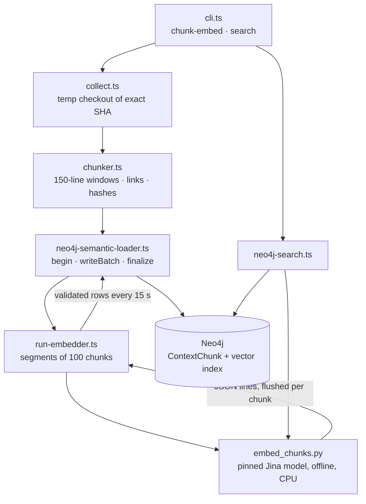
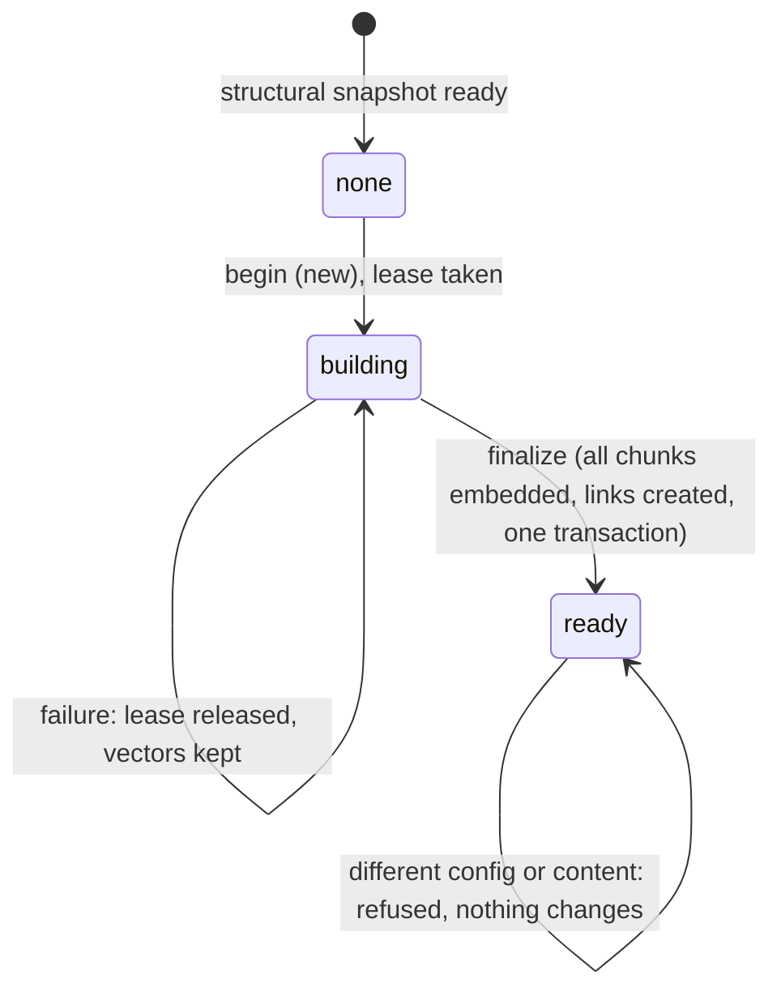
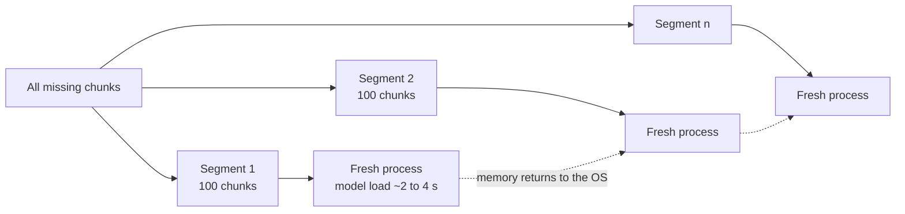
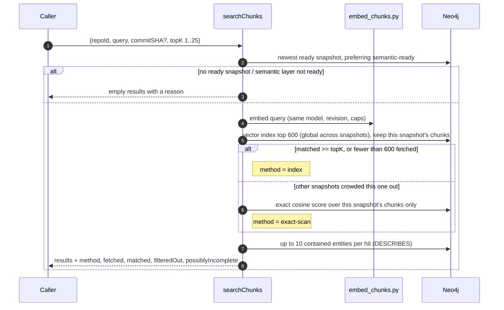

# Design: semantic code chunks

Status: implemented and run on the execution host on 2026-10-06; results are in `docs/design/verification.md`.

## Flow

`chunk-embed <repoId> <repoPath> <sha>`:
1. Temporary checkout of the exact SHA (same symlink and submodule refusal as extraction); walk chunkable files within bounds.
2. Cut windows (`ingestion/chunks/chunker.ts`), read the snapshot's entities from Neo4j, compute links, compute the semantic config hash and content hash (config, chunk layout, links; vectors excluded).
3. `begin` (one write transaction, takes the repository write lock): require a ready structural snapshot; start, resume or report `unchanged`; refuse config or content conflicts; take a 35-minute lease.
4. Embed only chunks that have no vector yet by running `embed_chunks.py` in child processes of 100 chunks each (structured arguments, no shell, offline). Each appends one JSON line per chunk with its token count and a token-truncation flag. TypeScript reads the file while it grows, validates every row (dimension 768, finite numbers, known ids, no duplicates), and saves rows to Neo4j every 15 seconds, renewing the lease. If a child fails, times out or is killed, rows already saved are kept, the lease is released and the run errors.
5. `finalize` (one write transaction): require all chunks present and embedded, create `DESCRIBES` links, then set `semanticStatus = ready`. Readers see the links and the status together at commit.

`search <repoId> <query> [sha|-] [topK]`: resolve the latest snapshot whose semantic layer is ready (or the given commit), embed the query with the same model, call `db.index.vector.queryNodes('context_chunk_embedding', 600, vector)`, keep only that snapshot's chunks (if other snapshots crowd it out of the top 600, score only this snapshot's chunks exactly and report `method: exact-scan`), return file, line range, score, truncation flag and up to 10 contained entities, plus `fetched`, `matched`, `filteredOut` and `possiblyIncomplete` (matched < requested while the 600-row fetch was full).

## Data model

`(ContextSnapshot)-[:HAS_CHUNK]->(ContextChunk)-[:DESCRIBES]->(ContextEntity)`. Chunk properties: `snapshotId`, `id` (`<snapshot>::chunk::<file>::<startLine>`), `file`, `startLine`, `endLine`, `charCount`, `embeddedChars`, `truncated`, `embedding`. Snapshot properties: `semanticStatus`, `semanticConfigHash`, `semanticContentHash`, model, model revision, code revision, dimension, chunk lines, max embed chars, extensions, chunk/truncated/link counts, `semanticTimestamp`, and while building `semanticLeaseOwner` / `semanticLeaseExpires`.

## Offline model

`Dockerfile.base` bakes the pinned model and remote-code revisions into `HF_HOME=/hf` at image build (`prefetch_model.py`), sets `HF_HUB_OFFLINE=1`, and the TypeScript runner sets it again for the child process. `trust_remote_code=True` executes Python from the code repo; the pinned revision is what makes that reviewable. The prefetch also points the cache's `main` ref at the pinned commit, because the model's remote code loads its tokenizer by repo name without a revision.

## Host verification commands (in order)

Run from `~/projects/taffee-context` on the host; check `free -m` and `uptime` before each model run and run one model container at a time.

1. Build: `docker build -f Dockerfile.base -t taffee-base:dev .`
2. Typecheck and unit tests: `docker run --rm -v $(pwd):/workspace -w /workspace taffee-base:dev bash -c 'npm install && npm run typecheck && npm test'`
3. Live tests (fake embedder, no model): same plus `--network host -e TAFFEE_NEO4J_TEST=1 -e NEO4J_URI=... -e NEO4J_PASSWORD=...`.
4. Fixture: `ingest`, `chunk-embed`, repeat `chunk-embed` (expect `unchanged`), `search` with on-topic and off-topic queries.
5. One real repo: `chunk-embed` in the background with a log, then `search`.

Record: chunk, truncated and link counts, model load and embedding seconds, peak RSS, host load and available memory.

## Assumptions most likely to fail

- Model download and revision pin (checked: baked at build; matches verified model revisions).
- `transformers` must stay on 4.57.1.
- Vector index syntax on Neo4j 5.26 (checked on 5.26.0-community).
- Run time on the 2-core / 4-thread host: 2.0 to 2.6 s per chunk (NestJS, FastAPI), so a repo with a few thousand chunks takes over an hour.

## Update 2026-10-07: memory

The embedder needs about 1.0 GB resident for typical chunks and spikes with token count squared. Run model containers with `--memory` equal to `--memory-swap` and set `EMBED_MAX_TOKENS=2048` on a host with 2 GB or less to spare (peak 1,849 MB on FastAPI). `EMBED_TIMEOUT_MS` (default 2 hours per process) and `EMBED_SEGMENT` (default 100 chunks per process) are the other knobs.

---

# Detailed design (as built)

## Components

| Component | File | Responsibility |
|---|---|---|
| Chunker and config | `ingestion/chunks/chunker.ts` | `SEMANTIC_CONFIG`, `chunkSource` (windows), `computeLinks`, `semanticConfigHash`, `semanticContentHash`, `decideSemanticStart`, `configFromEnv` |
| Source collector | `ingestion/chunks/collect.ts` | Temp clone and checkout of the exact SHA; refuses submodules and symlinks; walks chunkable files within bounds |
| Embedder runner | `ingestion/embeddings/run-embedder.ts` | Spawns the Python embedder in segments, reads its growing output file, validates every row, hands batches to the loader |
| Embedder | `ingestion/embeddings/embed_chunks.py` | Loads the pinned model offline, writes one JSON line per chunk (vector, token count, token-truncation flag) |
| Semantic loader | `ingestion/load/neo4j-semantic-loader.ts` | `begin` (lease), `writeBatch` (incremental save), `finalize` (links and `ready`), `release` |
| Search | `retrieval/query/neo4j-search.ts` | Query embedding, vector index lookup, exact-scan fallback, entity lookup per hit |
| Schema V2 | `storage/neo4j/schema.ts` | Chunk uniqueness constraint and the cosine vector index (768 dimensions) |



## `chunk-embed` sequence

```mermaid
sequenceDiagram
    autonumber
    participant Op as Operator
    participant L as Semantic loader
    participant C as collect.ts / chunker.ts
    participant DB as Neo4j
    participant R as Embedder runner
    participant P as embed_chunks.py (child process)

    Op->>L: chunk-embed repoId repoPath sha
    L->>C: collectSource (temp clone, exact SHA, bounds)
    C-->>L: files
    L->>C: chunkSource, computeLinks, config hash, content hash
    L->>DB: read the snapshot's entities (localId, sourceFile, sourceLocation)
    L->>DB: begin: repo write lock, decide start, take 35 min lease
    alt unchanged (ready, same hashes)
        L-->>Op: unchanged (no model load)
    else new / resume / restart
        L->>DB: which chunks already have a vector?
        loop each segment of 100 chunks still missing
            L->>R: embed(segment)
            R->>P: spawn with pinned revisions, HF offline, token cap
            P->>P: load model, then per chunk: tokenize, encode, append JSON line, flush
            loop every 15 s while the child runs
                R->>R: read newly written complete lines, validate
                R->>L: onRows(batch)
                L->>DB: check lease, MERGE ContextChunk nodes with vectors, renew lease
            end
            P-->>R: exit (meta: seconds, peak RSS)
            R->>L: final rows
        end
        L->>DB: finalize (one transaction): counts must match plan
        L->>DB: create DESCRIBES links, verify link count
        L->>DB: SET semanticStatus = ready, remove lease
        L-->>Op: created / resumed / restarted with counts and timings
    end
    note over L,DB: on any error the lease is released; saved vectors stay for the next run
```

## Semantic status state machine



Rules enforced by `decideSemanticStart`: no status means `new`; a different config hash on an incomplete layer means `restart`, on a complete layer it throws "Immutable semantic config conflict"; the same config with a different content hash throws "Immutable semantic content conflict"; otherwise `ready` means `unchanged` and `building` means `resume`. A resume, restart or new start is refused while another builder holds an unexpired lease ("Semantic build already in progress").

## Identity, hashes and what is immutable

- Chunk id: `<snapshotId>::chunk::<file>::<startLine>`. Windows are 150 lines, numbered from 1; windows that are whitespace-only are skipped and later windows keep their true line numbers.
- Config hash: SHA-256 of model, model revision, code revision, dimension, chunk lines, character cap and sorted extensions. The token cap joins the hash only when it is below 8192, so snapshots built before the cap existed stay valid.
- Content hash: SHA-256 of the config hash, the sorted chunk layout (id, file, lines, counts, truncation) and the links. Vectors are excluded because floating-point output is not guaranteed bit-identical across hardware.
- Links: a chunk is linked to every entity whose `sourceFile` equals the chunk's file and whose start line (`L<number>`) falls inside the chunk's line range. No name matching. Entities with a malformed location are skipped.
- A complete layer cannot be changed. To change the model, windows or caps, build under a new snapshot or restart an incomplete layer.

## Truncation, in two places

| Kind | Where | Flag | Effect |
|---|---|---|---|
| Characters | `chunkSource` cuts at 8000 chars (never inside a surrogate pair) | `truncated`, with `charCount` and `embeddedChars` | Only the first 8000 chars are embedded |
| Tokens | `embed_chunks.py` counts tokens and the model cuts at `--max-tokens` | `tokenTruncated`, with `embeddedTokens` | Bounds attention memory; recorded per chunk and as a snapshot count |

Chunk text is never stored in Neo4j; results carry file and line range and the code is read from Git when needed.

## Memory and process control

Attention memory grows with the square of the token count and the model process also grew over a long run, so three controls bound it:



- `EMBED_SEGMENT` (default 100): a new embedder process per segment resets resident memory.
- `EMBED_MAX_TOKENS` (default 8192, range 128 to 8192): per-chunk token cap, part of the semantic config.
- Container `--memory` equal to `--memory-swap`: an overrun kills the container instead of pushing the host into swap.
- Rows are saved every 15 s while the model runs, so a freeze or kill loses seconds of work, not the repository.

## Search



The index is global, so a result list is always filtered to one snapshot. `filteredOut` and `possiblyIncomplete` tell the caller when that filter ate into the requested count. The exact-scan fallback is exact and bounded by the 20,000-chunk limit.

## Configuration reference

| Setting | Default | Meaning |
|---|---|---|
| `EMBED_MAX_TOKENS` | 8192 | Per-chunk token cap; below 8192 it joins the config hash |
| `EMBED_SEGMENT` | 100 | Chunks per embedder process |
| `EMBED_TIMEOUT_MS` | 7,200,000 (2 h) | Timeout for one embedder process |
| `TORCH_THREADS` | 2 | CPU threads for the model |
| `EMBED_PYTHON` / `GRAPHIFY_PYTHON` | `python3` | Interpreter that runs the embedder |
| Save interval | 15 s | Not an env setting; option of `pythonEmbedder` |
| Lease | 35 min, renewed on every batch write | Prevents two builders per snapshot |

Bounds: 5000 files, 1 MiB per file, 20,000 chunks, 256 MiB of embedding output, 120 s to collect source.

## Failure modes

| Failure | Behaviour |
|---|---|
| No ready structural snapshot | `chunk-embed` stops: "A ready structural snapshot is required" |
| Embedder fails, times out or is killed | Saved rows kept, lease released, run errors; snapshot stays `building` and is not searchable |
| Second builder while a lease is held | Refused; no second model load |
| Wrong vector dimension, NaN or infinity, unknown or duplicate id | Row rejected, run fails |
| Stored chunk count differs from the plan at finalize | Finalize fails; no links, not `ready` |
| Config differs on a complete layer | "Immutable semantic config conflict" |
| Layout or links differ for the same config | "Immutable semantic content conflict" |
| Over the file, size or chunk bounds, symlink, submodule | Refused before embedding |
| Model files not in the image | Embedder fails offline; nothing is downloaded at run time |

## Security notes

- The embedder runs as a child process with structured arguments (no shell) and `HF_HUB_OFFLINE=1`.
- `trust_remote_code=True` runs Python from the pinned code revision; the pin is what makes that reviewable.
- No hosted API, no API key, no network at run time. Source is read from a temp checkout of the exact commit, so untracked files are never embedded.
- Search arguments are validated (known keys only, query up to 1000 characters, topK 1 to 25).
