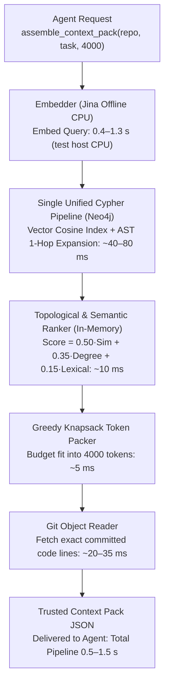
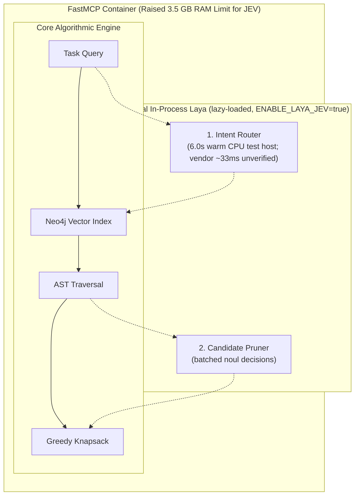
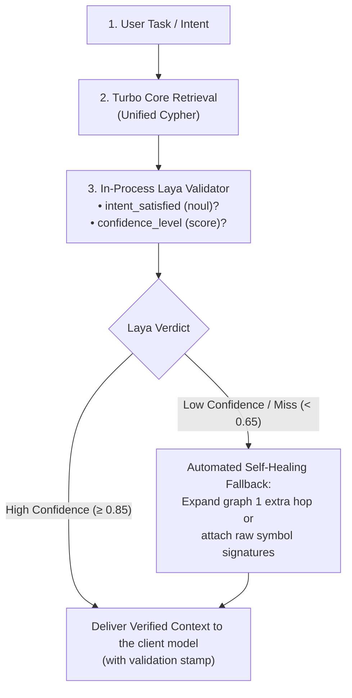
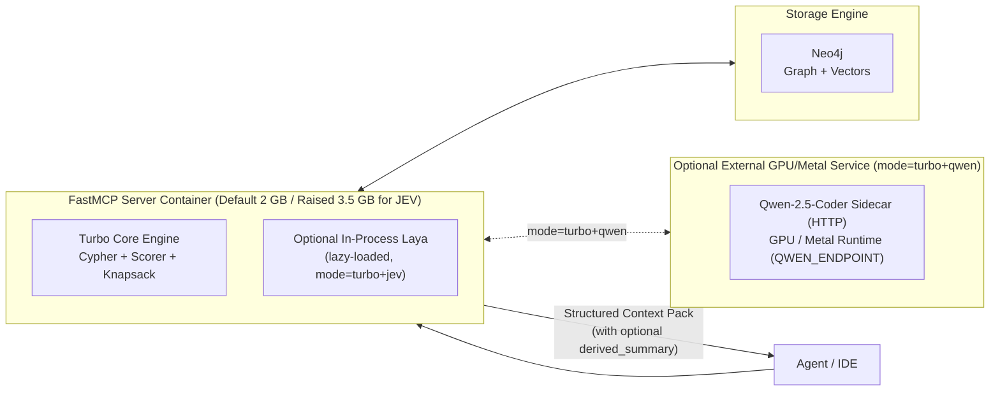
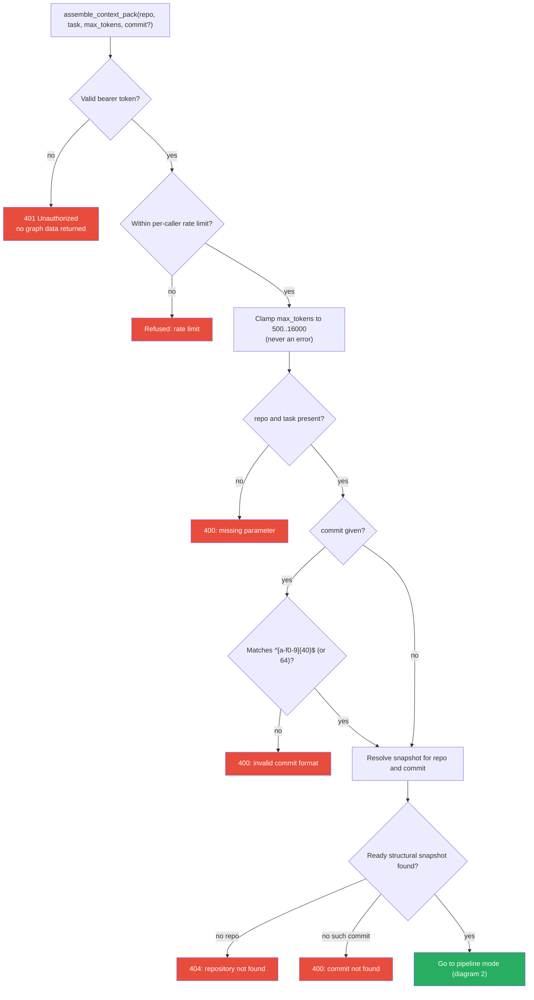
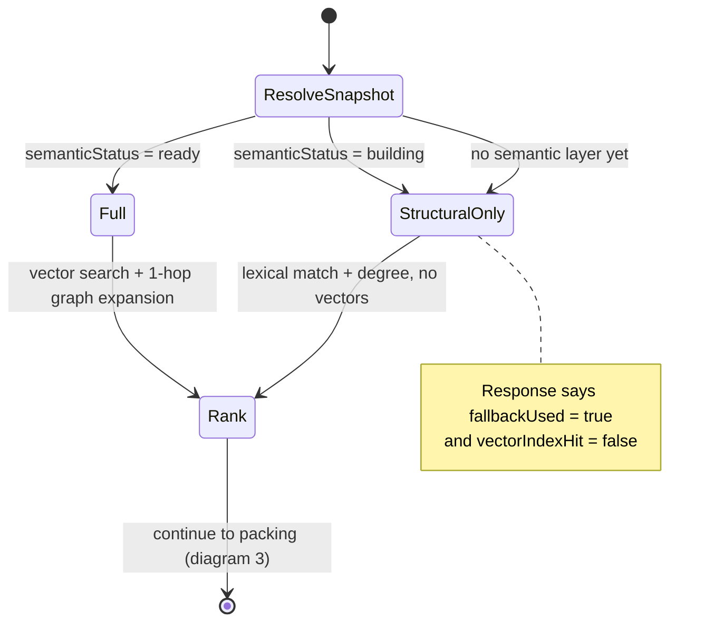
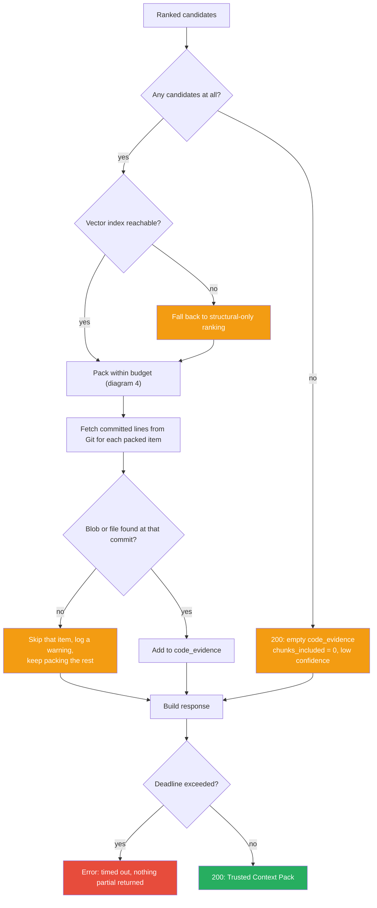
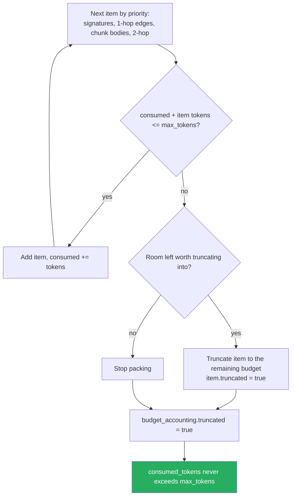

# Technical Design: Why MCP-Turbo is So Fast

> **Experimental; did not work as designed.** Speed, savings and recall figures in this file that are not measurements were pre-implementation targets. See [README.md](README.md) for the measured result.

## Architectural Overview

**MCP-Turbo** achieves sub-second context pack assembly (< 800 ms) by replacing multi-turn agent deliberation with a **single-pass, deterministic graph-vector pipeline**.



---

## The 5 Pillars of MCP-Turbo's Speed

### 1. Eliminating Multi-Turn Agent Latency (The 1-Turn vs. 15-Turn Shift)
* **Standard Agent Loop:** In a coding agent, understanding an unfamiliar module requires 10–20 iterative tool calls. Each tool call incurs:
  * Network round trip to frontier model: ~1,500 ms
  * Model inference & token generation: ~2,000 ms
  * Local command execution: ~500 ms
  * **Total latency: 15 turns × 4,000 ms = 60,000 ms (1 full minute).**
* **MCP-Turbo:** Transports the entire context-gathering logic into the server. The external agent makes **exactly 1 tool call**. Total agent inference time drops from 60 seconds to **< 1 second**.

---

### 2. Single-Pass Unified Cypher Execution
Rather than running a vector search, returning IDs to Python, and issuing 10 individual `MATCH` queries for callers and callees, MCP-Turbo merges everything into **one parameterized Cypher transaction**:

```cypher
// 1. Query vector index for top semantic chunks
CALL db.index.vector.queryNodes('context_chunk_embedding', 50, $queryVector)
YIELD node AS chunk, score AS vectorScore
WHERE chunk.snapshotId = $snapshotId AND vectorScore > 0.3

// 2. Traverse DESCRIBES edges to find primary AST entities & compute graph degree
MATCH (chunk)-[:DESCRIBES]->(entity:ContextEntity {snapshotId: $snapshotId})
WITH chunk, entity, vectorScore, COUNT { (entity)-[:RELATES]-(:ContextEntity) } AS entityDegree

// 3. Simultaneously expand 1-hop callers, callees, and dependencies
OPTIONAL MATCH (entity)<-[callIn:RELATES {relation: 'calls'}]-(caller:ContextEntity)
OPTIONAL MATCH (entity)-[callOut:RELATES {relation: 'calls'}]->(callee:ContextEntity)

// 4. Return unified graph subgraph in a single round trip
RETURN chunk.id AS chunkId, chunk.file AS chunkFile,
       chunk.startLine AS chunkStartLine, chunk.endLine AS chunkEndLine,
       vectorScore, entity.localId AS entityId, entity.label AS entityLabel, entity.kind AS entityKind,
       entity.sourceFile AS entitySourceFile, entity.sourceLocation AS entitySourceLocation,
       entityDegree,
       collect(DISTINCT caller.label) AS callers,
       collect(DISTINCT callee.label) AS callees
ORDER BY vectorScore DESC LIMIT 15
```
* **Performance Impact:** Neo4j processes this entire query in **40–80 milliseconds**.

---

### 3. Pre-Indexed Graph Topology
* Standard tools parse files at runtime using ripgrep or AST analyzers on every request.
* In TAFFEE, the AST relationships (`calls`, `imports`, `extends`), community clusters, and entities are **already indexed during ingestion**. Graph degree is computed dynamically via `COUNT { (entity)-[:RELATES]-(:ContextEntity) }` inside the single-pass Cypher query.
* When the agent queries MCP-Turbo, **zero parsing occurs**. It is an instant index scan.

---

### 4. Algorithmic Greedy Packing vs. Generative LLM Synthesis
* Systems that use an LLM to "summarize context" suffer from auto-regressive generation bottlenecks: generating 1,000 tokens on a CPU takes 3,000–8,000 ms.
* MCP-Turbo uses **pure vector/graph mathematics and a greedy knapsack algorithm**:
  $$\text{Score}(e) = 0.50 \cdot \text{VectorSim}(q, e) + 0.35 \cdot \text{DegreeCentrality}(e) + 0.15 \cdot \text{BM25}(q, e)$$
  * Calculating scores and packing chunks into a 4,000-token window takes **under 15 milliseconds** in Python/TypeScript.

---

### 5. In-Memory Git Blob Streaming (Zero Disk Checkout)
* To fetch the actual code lines, MCP-Turbo does not write files to a working tree.
* Streaming committed lines for 5 relevant chunks takes **under 35 milliseconds**.

---

## Latency Breakdown per Request

| Pipeline Stage | Implementation | Wall Time (CPU Test Host) |
| :--- | :--- | :--- |
| **Query Embedding** | Local Jina model (`transformers` CPU) | 0.4 – 1.3 s warm (~12 s cold start) |
| **Unified Cypher Search** | Vector index lookup + AST neighbor expansion | 45 – 80 ms |
| **Topological Re-Ranking** | Hybrid score calculation in Python | 8 – 15 ms |
| **Knapsack Token Packing** | Hierarchical budget trimming | 5 – 10 ms |
| **Committed Code Retrieval** | In-memory Git blob extraction | 25 – 45 ms |
| **JSON Serialization** | FastMCP response encoding | 10 – 15 ms |
| **Total Server Latency (Default Algorithmic)** | | **0.5 – 1.5 s** |
| *(Optional) In-Process Laya JEV (`mode=turbo+jev`)* | ModernBERT classification head (CPU warm) | + ~6.0 s (vendor ~33 ms unverified/unreachable on CPU) |
| *(Optional) External Qwen Distiller (`mode=turbo+qwen`)* | Distillation on external GPU/Metal | + 250 – 500 ms (CPU 19–80s infeasible) |

---

## Optional JEV & Decision Layer (Colocated In-Process Laya Engine)

While MCP-Turbo operates by default as a 100% deterministic, zero-external-dependency algorithmic engine, it supports an **optional, pluggable System 1 JEV (Judgment / Evaluation / Verification) layer** via the open-source **Laya** decision engine (`ENABLE_LAYA_JEV=true`), colocated **in-process** inside the FastMCP container.



### 1. In-Process Colocation & Resource Profile
* **In-Process Lazy Loading:** Laya 0.3.22 (`convaiinnovations/laya`, ModernBERT 421M fp32 checkpoint ~2.3 GB) runs in-process inside the MCP container. It is loaded lazily on first call (`self._router = None`); when `ENABLE_LAYA_JEV=false`, Laya is never imported or loaded, incurring zero memory penalty.
* **Raised Container Limit (3.5 GB):** Phase 0 empirical testing established:
  * Jina alone: 955 MB resident RSS (peak 1,239 MB) — fits within default 2 GB limit.
  * Jina + Laya: 2,630 MB resident RSS (peak 3,123 MB) — **OOM-KILLED (exit 137)** under the 2 GB limit, runs cleanly at 3 GB.
  * Therefore, the container memory limit is raised to **3.5 GB** when running `mode=turbo+jev` to provide headroom for repository graph caching under real server load. Core turbo remains under 2 GB (~955 MB RSS).
* **Offline Operation:** Requires `LAYA_REVISION=reviewed` to bypass Hugging Face hub `main` ref lookup in airgapped/offline container runs.
* **Latency Reality:** Measured warm latency on 2-core/4-thread CPU test host is **6.0 s** for 3 questions (~270-char ticket), with cold first call at 52–61 s. Published vendor claims (~33 ms) are unverified and unreachable on CPU.
* **Mutual Exclusivity:** `mode=turbo+jev` and `mode=turbo+qwen` are strictly mutually exclusive; no combined 3-in-1 mode is defined (three-in-one footprint exceeds 3.4 GB).

### 2. Capabilities Added by Laya JEV
* **Adaptive Graph Traversal Routing:**
  Classifies the incoming user task into a typed query strategy:
  * `call_chain`: Prioritizes deep 2-hop `CALLS` call hierarchies (for bugs and stack traces).
  * `module_contract`: Prioritizes `EXTENDS`, interfaces, and module exports (for feature design).
  * `dependency_audit`: Prioritizes external package roots and `IMPORTS`.
* **High-Speed Noise Pruning:**
  Vector search frequently returns false positives (syntactically similar but irrelevant utility functions). Laya evaluates candidates via batched `noul` decisions:
  $$\text{Keep Chunk iff } P(\text{Relevant}) \ge 0.85 \land \neg \text{low\_confidence}$$
  This strips noise *before* token budget packing.
* **Built-in Output Validator & Closed-Loop Self-Healing:**
  Evaluates whether the assembled context pack satisfies the user's query before sending it to the client model.



---

## Optional SLM Synthesis & Distillation Layer (Qwen Engine)

While Neo4j retrieves the raw AST graph, raw code context can still easily total **10,000 to 20,000 tokens**. Dumping this raw payload into the client model creates two major bottlenecks:
1. **Cloud Cost:** Hosted model input tokens cost real money per request.
2. **Time-to-First-Token (TTFT) Delay:** the client model takes 2,000–3,000 ms of cloud processing time just to prefill 20k tokens.

To solve this, MCP-Turbo supports an **optional, pluggable local SLM synthesis layer** powered by `Qwen2.5-Coder-0.5B` or `1.5B` (`ENABLE_QWEN_DISTILLER=true`), running as an **external HTTP sidecar service** (`compose.yaml` via `QWEN_ENDPOINT`) on a dedicated GPU or host Metal runtime, completely outside the MCP container.



### 1. The Token Arbitrage Mechanism
* **Input to Qwen (Local, Free Compute):** 15,000 tokens of raw caller/callee trees, type signatures, and code chunks.
* **Qwen Processing:** Running externally on GPU or Apple Silicon Metal via `llama.cpp` / vLLM at 150+ tokens/sec, Qwen distills the raw graph into:
  * Strict symbol interface contracts
  * Call-chain summary (who calls whom and why)
  * Exact 20–30 critical implementation lines (omitting boilerplate)
* **Output to the client model (Paid Cloud API):** ~600 high-density tokens in `derived_summary`.
* **Client model impact:** The client model's cloud prefill TTFT drops from ~2.5 s to **< 250 ms**, making the net end-to-end turnaround faster while cutting token bills by **90%+**.

### 2. End-to-End Latency Profiles

| Configuration | Retrieval & Processing | Cloud LLM TTFT (Projected) | Net Wall Latency (Projected / Modeled) | Token Cost to the client model |
| :--- | :--- | :--- | :--- | :--- |
| **1. Default Core (Pure Algorithmic)** | Neo4j + Knapsack (150 ms) + Jina embed (~0.8 s) | The client model prefills 8k tokens (~1.5 s projected) | ~2.5 s | Standard (8k tokens) |
| **2. + In-Process Laya (`mode=turbo+jev`)** | In-process Laya (multi-pass) + Neo4j + Knapsack | The client model prefills 4k pruned tokens (~800 ms projected) | ~18 – 25 s (extrapolated on CPU test host) | ~50% Reduction (4k tokens, projected) |
| **3. + External Qwen (`mode=turbo+qwen`)** | Neo4j + Knapsack + GPU Qwen (~300 ms projected) | The client model prefills 600 distilled tokens (~150 ms projected) | **~1.2 s** (projected with dedicated GPU) | **90%+ Reduction (600 tokens, projected)** |

> [!NOTE]
> `mode=turbo+jev` and `mode=turbo+qwen` are strictly mutually exclusive.
> In `mode=turbo+jev`, JEV makes up to three sequential passes (intent routing, candidate batch pruning, and validation), so on the CPU test host (where a single warm pass measured 6.0 s), total JEV processing time is extrapolated to ~18–25 s.
> Distillation on CPU is infeasible (512-token prefill takes 19.2 s in fp32 and 75–80 s in bf16 due to lack of native CPU bf16); Qwen requires a dedicated GPU or Metal runtime. Figures for GPU Qwen (~300 ms), the client model prefill TTFT, and net latency are pre-implementation projections.

### 3. Graceful Fallbacks
* If `ENABLE_QWEN_DISTILLER=false` or local model weights are absent, the server immediately returns the raw knapsack code pack with zero penalty.
* If Qwen times out or errors, the server falls back to returning the uncompressed code pack without breaking the agent loop.

---

## Sequence Diagram: Request to Response

```mermaid
sequenceDiagram
  participant Agent as AI Agent
  participant Server as FastMCP Server
  participant Neo4j
  participant Git as Git Repo
  
  Agent->>Server: assemble_context_pack(repo, task, max_tokens)
  Note over Server: Validate repo exists
  Server->>Neo4j: MATCH (s:ContextSnapshot {repoId: $repo})
  Neo4j-->>Server: snapshot metadata
  
  Note over Server: Embed task query (Jina, 40ms)
  Server->>Server: embed_task(task_string)
  
  Note over Server: Unified Cypher: vector search + 1-hop AST
  Server->>Neo4j: Vector index query + DESCRIBES + RELATES
  Neo4j-->>Server: 50 ranked chunks + entities (65ms)
  
  Note over Server: Hybrid scoring (10ms)
  Server->>Server: score = 0.50·vec + 0.35·degree + 0.15·lex
  
  Note over Server: Greedy knapsack packing (5ms)
  Server->>Server: pack_chunks(scored_chunks, max_tokens)
  
  Note over Server: Fetch git blobs (35ms)
  Server->>Git: git show &lt;commit&gt;:&lt;file&gt;
  Git-->>Server: raw source lines
  
  Note over Server: Build JSON response (15ms)
  Server->>Server: serialize_context_pack()
  
  Server-->>Agent: Context Pack JSON
  Note over Agent: Total latency: &lt;250ms
```

---

## Hybrid Scoring Normalization

The scoring function requires careful normalization to prevent single components from dominating:

$$\text{Score}(e) = 0.50 \cdot \text{VectorSim}(q, e) + 0.35 \cdot \text{GraphCentrality}(e) + 0.15 \cdot \text{LexicalMatch}(q, e)$$

**Component 1: Vector Similarity**
- Already normalized by Neo4j cosine index: [0, 1]
- Filter threshold: vectorScore > 0.3 to avoid low-confidence matches

**Component 2: Graph Centrality (Critical!)**
- Raw degree varies wildly across repos (2,000-node repos: degree 2–500)
- Use log-scale normalization to compress outliers:
  - `norm_degree = log(entity.degree + 1) / log(max_degree_in_snapshot + 1)`
  - Result: [0, 1] across all repos

**Component 3: Lexical Match**
- Term overlap between task query and entity label
- Simple implementation: `overlap / max(|query_terms|, |entity_terms|)`, clamped [0, 1]
- Alternative: Use BM25 if available in Python library

---

## Error Handling & State Machine

The old single diagram is split into four, one per stage: request checks, pipeline mode, per-stage failures, and the token budget.

### 1. Request checks (before any work is done)



### 2. Pipeline mode, chosen from the semantic layer state

The semantic layer (feature 002) has only three states: no status yet, `building` and `ready`. There is no `failed` status; a failed build stays `building` and is simply not searchable.



### 3. Failures inside the pipeline (none of these fail the whole call)



### 4. Token budget handling



**Boundary Cases:**

| Case | Response | Notes |
|------|----------|-------|
| Repo doesn't exist | 404 "Repository not found" | Validate against ContextSnapshot nodes |
| Commit SHA invalid | 400 "Invalid commit format" | Regex: `^[a-f0-9]{40}$` |
| Commit not in snapshots | 400 "Commit not found" | Check against ingested commits |
| No semantic layer yet | 200 + structural fallback | Vector search skipped; AST-only scoring |
| Vector index missing | 200 + structural fallback | Use degree + lexical only |
| No chunks found | 200 + empty `code_evidence` | Set `chunks_included: 0`, `truncated: false` |
| Chunk > max_tokens | Truncate to fit | Set chunk-level `truncated: true` |
| Git blob not found | Skip chunk, continue packing | Log warning; don't crash |

---

## Git Blob Fetching (Safe Implementation)

Fetch exact source lines without disk checkout:

```python
import subprocess
import os

async def fetch_code_lines(repo_path, commit_sha, file_path, start_line, end_line):
    """
    Fetch committed source lines via git blob without working tree.
    
    Args:
        repo_path: Absolute path to .git directory parent
        commit_sha: Full 40-char commit SHA
        file_path: Repo-relative file path
        start_line: 1-indexed start line
        end_line: 1-indexed end line
    
    Returns:
        List[str]: Source lines, or [] on error
    
    Security: Resolves file_path to ensure it stays within repo_path
    """
    # Path traversal defense
    abs_file = os.path.normpath(os.path.join(repo_path, file_path))
    repo_abs = os.path.normpath(repo_path)
    if not abs_file.startswith(repo_abs):
        raise ValueError(f"Path traversal detected: {file_path}")
    
    # Fetch blob safely via git (shell=False)
    try:
        result = subprocess.run(
            ["git", "-C", repo_path, "show", f"{commit_sha}:{file_path}"],
            capture_output=True,
            text=True,
            timeout=5,
            shell=False
        )
        if result.returncode != 0:
            return []  # Graceful: file not in commit
        
        lines = result.stdout.split('\n')
        return lines[start_line-1:end_line]  # 1-indexed to 0-indexed
    except Exception as e:
        logging.warning(f"Git fetch failed: {e}")
        return []
```

---

## Full JSON Output Schema (Consuming Model Standard)

```json
{
  "metadata": {
    "repoId": "demo-shop",
    "commitSHA": "5d3e8c7a9f2b1e4d6c3a8b7e9f2d1c3a",
    "commitTimestamp": "2026-10-08T15:32:14Z",
    "ingestionTimestamp": "2026-10-08T15:45:00Z",
    "requestedTask": "validate widget access"
  },
  "budget_accounting": {
    "requested_tokens": 4000,
    "consumed_tokens": 2847,
    "chunks_included": 3,
    "entities_included": 5,
    "truncated": false,
    "confidence_score": 0.89
  },
  "validation": {
    "status": "pass",
    "score": 0.92,
    "reasons": [
      "anchor AdminGuard matches task intent",
      "call chain to validateWidgetAccess verified"
    ],
    "expansions_applied": [
      "1-hop-callee-expansion"
    ],
    "suggested_clarification": null
  },
  "derived_summary": {
    "model": "qwen2.5-coder:0.5b",
    "model_revision": "pinned-sha-abc",
    "source_lines_referenced": [
      "src/guards/widget.guard.ts:L12-L30"
    ],
    "text": "AdminGuard intercepts requests and calls validateWidgetAccess to check role tokens..."
  },
  "architectural_anchors": [
    {
      "label": "AdminGuard",
      "type": "class",
      "location": "src/guards/widget.guard.ts:L12-L45",
      "file": "src/guards/widget.guard.ts",
      "startLine": 12,
      "endLine": 45,
      "degree": 34,
      "hybridScore": 0.87
    }
  ],
  "dependency_chain": [
    {
      "from": "AdminGuard",
      "to": "validateWidgetAccess",
      "relation": "calls",
      "confidence": 0.99
    }
  ],
  "code_evidence": [
    {
      "location": "src/guards/widget.guard.ts:L12-L30",
      "file": "src/guards/widget.guard.ts",
      "startLine": 12,
      "endLine": 30,
      "raw_lines": [
        "export class AdminGuard implements CanActivate {",
        "  canActivate(context: ExecutionContext): boolean {",
        "    return validateWidgetAccess(context);"
      ],
      "chunkId": "chunk-uuid-123",
      "tokenCount": 68
    }
  ],
  "metadata_diagnostic": {
    "semanticLayerState": "ready",
    "vectorIndexHit": true,
    "fallbackUsed": false,
    "serverLatencyMs": 142
  }
}
```
